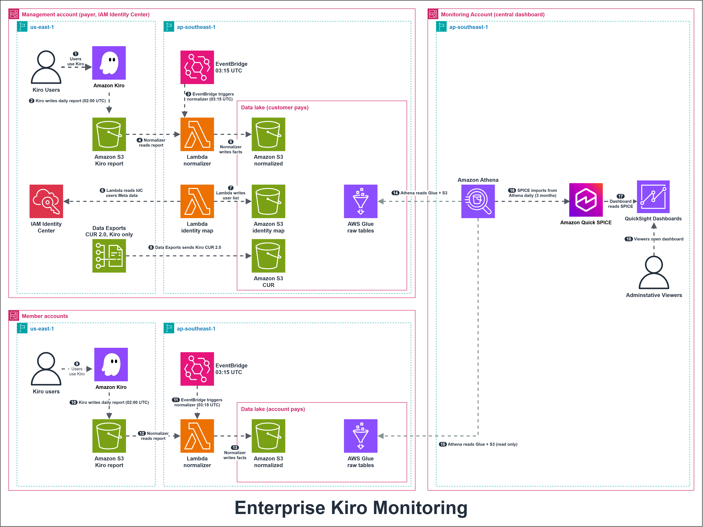

# Kiro Enterprise Monitoring

A design for monitoring how a customer's organization uses [Kiro](https://kiro.dev/), with every dashboard hosted in one central **observability management account**. The design combines three dashboards AWS already publishes with two log sources:

| Layer | Component | Question it answers | Data source |
|---|---|---|---|
| 1 | CUDOS, Kiro section | What does Kiro cost per month and per account? | CUR 2.0 |
| 2 | [CID Kiro User Activity Dashboard](https://docs.aws.amazon.com/guidance/latest/cloud-intelligence-dashboards/kiro-user-activity-dashboard.html) | Which licenses are paid for but idle, and who should move to another tier? | CUR 2.0 and the Kiro user activity report |
| 3 | Kiro Usage Analytics ([aws-samples/sample-kiro-user-analytics-quicksight-dashboard](https://github.com/aws-samples/sample-kiro-user-analytics-quicksight-dashboard)) | Who uses Kiro, whose usage is dropping, and which models are chosen? | Kiro user activity report |
| 4 | CloudTrail data events | Which request was made, by whom, when, and did it fail? | A trail that records data events only |
| 5 | Kiro prompt logging | What was asked and answered | One prompt log bucket in each account that has a Kiro profile |

## Architecture



One dashboard covers every Kiro account of an AWS Organization. Each account keeps its own report, data lake and Glue tables and pays for them; the monitoring account only reads. The numbers follow the diagram.

**Management account** (payer, IAM Identity Center)

1. Users sign in to Kiro with the organization's Identity Center; their subscriptions are billed here.
2. Kiro writes the daily user activity report (CSV) at about 02:00 UTC to a bucket in the same account, in the Kiro profile Region (prefix `kiro/`, SSE-S3).
3. EventBridge runs the normalizer Lambda at 03:15 UTC in the dashboard Region.
4. The normalizer reads the new report, keyed by column header (Kiro adds a `<model>_messages` column for each new model).
5. It writes per-user facts and per-model rows to the account's data lake, exposed by two Glue tables.
6. The identity-map Lambda reads users from Identity Center (the report carries only user IDs).
7. It writes the user ID to name and email table. Steps 6-7 run only here: the user store is organization-wide.
8. Data Exports delivers a Kiro-only CUR 2.0, the source for paid but idle licences.

**Member accounts**, one copy each, nothing shared

9. Users work in Kiro through the account's own Kiro profile.
10. Kiro writes the account's report to the account's own bucket.
11. The account's EventBridge rule starts the account's normalizer.
12. The normalizer reads the account's report.
13. It writes to the account's own data lake.

**Monitoring account** (read only)

14. Athena reads the management account's Glue tables and S3 through read-only resource policies.
15. The same for each member account.
16. SPICE imports from Athena once a day, over a rolling 3-month window.
17. The dashboard reads SPICE and filters by account.
18. Viewers open the dashboard; opening it runs no Athena query.

A dashed line means the monitoring account reads a customer resource (pull); it never writes there.

## Status

| Part | State |
|---|---|
| Management account, single-account pipeline (sample + patches P1-P8, P12) | Running since 2026-11-02. Dashboard totals match the raw CSV (users, messages, credits). Measured cost about $0.40 a month, excluding QuickSight licences |
| Per-account data plane, `infra/customer/data-lake` (patch P10) | Merged; `terraform test` 11/11 pass against mocked providers. Not applied to a member account yet |
| Cross-account catalog, views and dataset in the monitoring account | Next patch |
| Kiro-only CUR 2.0 export, `infra/customer/cur-export` | Written; cross-account delivery not measured yet |
| Prompt logging phase 1 (store only), `infra/customer/prompt-logs` | Spec updated 2026-11-04; pilot in a management account next. Retention (D12) not decided yet |

Pilot steps for one member account: [`docs/MEMBER-ACCOUNTS.md`](docs/MEMBER-ACCOUNTS.md).

## Design points

- **Pull, not push.** Kiro writes the activity report and the prompt log only to a bucket in the account where users are subscribed; Kiro does not support a bucket in another account. Lambdas in the observability management account read the customer's report bucket, and the customer only adds a bucket policy.
- **The report bucket must use SSE-S3 under the `kiro/` prefix.** The CID collector does not support SSE-KMS source buckets, and the Data Collection Stack does not pass a prefix to the Kiro module, so the module default `kiro/` always applies.
- **Prompt logs are stored first, read centrally later.** Phase 1 only stores them: one SSE-S3 bucket per account with a Kiro profile, in that account and the profile's Region, with a retention lifecycle. Phase 2 lets named roles of the monitoring account read them through the cross-account catalog (decision D11); until a role is listed, no principal of the monitoring account can read them. Content analysis is a later phase. The metadata-only Lambda (`prompt-metadata`) is kept in the repo but no longer deployed.
- **One Kiro Usage Analytics deployment per customer.** The sample has no account column, so customers would mix in one deployment. The vendored sample carries these patches ([`vendor/PATCHES.md`](vendor/PATCHES.md)):
  - P1: make the report path take a source account instead of the deploying account.
  - P2: turn the preflight bucket check into a warning when the bucket belongs to another account.
  - P3: pass an ExternalId when the identity-map Lambda assumes the customer's role.
  - P4: encrypt the identity-map bucket with SSE-S3 instead of a dedicated KMS key.
  - P5: optional permissions boundary on every role the sample creates.
  - P6: no default start for the Athena partition projection; `deploy.sh` stops if `PROJECTION_START` is missing.
  - P7: a scoped inline Athena and Glue policy per deployment on the QuickSight service role, instead of relying on the shared managed policy.
  - P8: remaining monthly credits per user, with OK, WATCH, AT_RISK and EXHAUSTED states.
  - P12: list lookups in `deploy.sh` and `preflight.sh` no longer crash or read a long list as "not found" (a `grep -Fi` abort in Git Bash, and `grep -q` under `pipefail`).
- **Rolling projection window.** Partition projection lists one S3 prefix per day in its range on every read. Upstream projects `2020-01-01,NOW+1YEARS`, about 2,860 mostly empty prefixes per table read. The tables now use `NOW-3MONTHS,NOW` (about 92), and the Terraform module refuses a future end date.
- **Daily refresh.** Kiro exports once a day, so SPICE refreshes once a day after the normalizer. A 15-minute refresh would only re-read the same data and multiply S3 request costs.
- **Data lake in the dashboard Region.** Athena reads another account's Glue catalog only in the same Region; the report stays in the Kiro profile Region.
- **No KMS keys.** The CloudTrail, prompt-log and identity-map buckets use SSE-S3 (decision D9). A KMS version needs three keys per customer, and at 200 customers the keys and decrypt requests were about 1,820 of 2,220 USD a month in the estimate. The trade-off: read access depends on S3 and IAM permissions alone, with no second `kms:Decrypt` check.
- **Only the cost layers have history.** CUR can be backfilled for up to 14 months; the activity report, CloudTrail and prompt logs start on the day they are enabled.

## Cost estimate

[AWS Pricing Calculator: 200 customers, month 13+, no KMS, 1 author, audit Direct Query](https://calculator.aws/#/estimate?id=55ea2e104669c6c5565d79a8ef7b473076be2694). Click **Update estimate** after opening it, so the calculator recomputes at current prices.

| Assumption | Value |
|---|---|
| Customers | 200, each with 100 Kiro users |
| Data events | 100 per user per day, 22 working days (not measured yet, OQ-1) |
| Retention | 13 months (D5), so the figures are for month 13 onward |
| QuickSight | 1 author, no readers, operator only (D1) |
| Audit dashboard | Direct Query, no SPICE copy (D10); 100 dashboard opens x 4 visuals a month across all customers |
| Encryption | SSE-S3 everywhere, no KMS keys (D9) |

S3 request counts come from the design, not round numbers: CloudTrail delivers about one log file per 5 minutes of activity plus one digest file per hour; the sample's request counts scale its own 30-day measurement to 13 months of history; prompt-log file cadence is not measured yet (OQ-9).

Computed from the public AWS price list files, not read from the calculator total: about 120 USD a month. Of that, about 54 USD (CloudTrail data events and the customer-side S3 buckets) is billed to the customers' own accounts. Half of the total grows with the number of users, so doubling the users per customer raises it by about 50%.

## Open questions

These must be measured before the related layers are built. Each one has a task in [`tasks.md`](.kiro/specs/kiro-customer-monitoring/tasks.md):

| ID | Question |
|---|---|
| OQ-1 | Does Kiro emit CloudTrail data events of type `AWS::CodeWhisperer::Profile`, which event names, and how many per chat message? |
| OQ-2 | Does the CloudTrail `requestID` match the `requestId` in the prompt log? |
| OQ-3 | Do the user IDs in the activity report, CloudTrail and the prompt log share one format? |
| OQ-7 | Do CUDOS and CID work on a CUR export filtered to Kiro line items only? |
| OQ-11 | Can a trail in the Kiro profile Region deliver to a bucket in another Region? |

The full list (OQ-1 to OQ-13) and the decisions still open (D1 to D8) are in [`design.md`](.kiro/specs/kiro-customer-monitoring/design.md).

## Repository layout

| Path | Content |
|---|---|
| `.kiro/specs/kiro-customer-monitoring/requirements.md` | 19 requirements, 96 acceptance criteria in EARS notation (Vietnamese) |
| `.kiro/specs/kiro-customer-monitoring/design.md` | Architecture, evidence from AWS docs and source code, patches, data models, decisions, open questions (Vietnamese) |
| `.kiro/specs/kiro-customer-monitoring/tasks.md` | Implementation tasks with owner, dependencies and a measurable done check (Vietnamese) |
| `diagrams/kiro-customer-monitoring.drawio` | The architecture diagram above, edited by hand in draw.io |
| `diagrams/kiro-enterprise-monitoring-architecture.png` | Current architecture diagram (management, member and monitoring accounts), used in this README |
| `diagrams/kiro-customer-monitoring.png` | Earlier PNG export of the hand-edited diagram above, kept for reference |
| `diagrams/kiro-customer-monitoring-chi-tiet.drawio` | Detailed two-page diagram with notes (data flow, cross-account permissions), generated |
| `diagrams/build_architecture.py`, `diagrams/drawio_lib.py` | Generator for the detailed diagram, with a geometry check |
| `diagrams/verify_drawio.py` | Independent diagram check: XML, dangling edges, AWS4 icon names, note fit, page bounds |
| `LICENSE` | MIT License |
| `vendor/sample-kiro-user-analytics-quicksight-dashboard/` | The layer 3 sample at upstream commit `1f5f5b8` (MIT-0), plus patches P1-P8 and P12 (listed under Design points) |
| `vendor/PATCHES.md` | Upstream pin, SHA256 of patched files, every patched line, test results before and after |
| `tools/survey_customer.py` | Read-only survey of a customer's accounts. Stops before any other call if a profile is not the expected account |
| `tools/measure_oq.py` | Measures the open questions from temporary buckets. Prints only counts and ID shapes, never content |
| `tools/scan_staged.py` | Blocks account IDs, Identity Store IDs, `ssoins-` IDs, customer names and em dashes in `*.tf` from commits |
| `tools/build_audit_views.py` | Renders the audit view. Never selects source IP, request payloads or the full user agent |
| `tools/reconcile.py` | Checks dashboard numbers against a second source (Cost Explorer, CID vs sample) and writes the customer baseline |
| `tools/package_sample.py` | Reproducible zip of the patched sample for CloudShell, with a SHA256 file |
| `infra/customer/` | Customer-side modules: data lake per Kiro account (report bucket, backup, normalizer, Glue tables), report bucket policy, Identity Center read role, data-event trail, prompt-log bucket, prompt metadata Lambda, Kiro-only CUR export |
| `infra/observability/` | Observability-side modules: trail bucket, prompt metadata bucket, audit dashboard, freshness check |
| `infra/roots/` | Roots per account (`customer`, `member-account`, `payer`, `observability-customer`, `shared`), each with `allowed_account_ids` and a `terraform.tfvars.example` |
| `infra/experiments/oq/` | Temporary resources that measure the open questions |
| `infra/tests/` | `terraform test` for every module and root, against mocked providers |
| `docs/RUNBOOK.md`, `docs/TEARDOWN.md` | Operating and removal procedures (Vietnamese) |
| `docs/MEMBER-ACCOUNTS.md` | Customer-side data plane per Kiro account: what it creates, pilot steps, adopting an existing report bucket, backup check (English) |
| `infra/observability/freshness/` | Terraform module and Lambda for the daily freshness check and SNS alert |
| `customers/_template/` | Empty customer config. Every other folder under `customers/` is gitignored |
| `docs/customer-config.md`, `docs/data-inventory-template.md` | Config field rules, and the data inventory the customer signs per layer |

## Offline checks

None of these need AWS credentials.

```bash
python -m unittest discover -s tools/tests
python -m unittest discover -s infra/observability/freshness/tests
python -m unittest discover -s infra/customer/prompt-metadata/tests
cd vendor/sample-kiro-user-analytics-quicksight-dashboard && PYTHONPATH=tests python -m unittest discover -s tests && cd -
cd infra/tests && terraform init -backend=false && terraform test && cd -
python tools/scan_staged.py   # on what is staged for commit
```

`terraform test` plans and applies every module against mocked AWS providers, so it creates nothing and needs no credentials. It checks the policies, names and guards; it cannot prove that AWS accepts them. That happens at the first real `terraform plan` of each root.

## Working with the diagrams

Export the main diagram to PNG after editing it (draw.io desktop CLI):

```bash
draw.io --export --format png --scale 2 --border 20 \
  --output diagrams/kiro-customer-monitoring.png diagrams/kiro-customer-monitoring.drawio
```

Regenerate the detailed diagram (the script never writes the hand-edited main diagram):

```bash
python diagrams/build_architecture.py
```

Verify a diagram against draw.io's AWS4 icon library:

```bash
curl -o Sidebar-AWS4.js https://raw.githubusercontent.com/jgraph/drawio/dev/src/main/webapp/js/diagramly/sidebar/Sidebar-AWS4.js
python diagrams/verify_drawio.py diagrams/kiro-customer-monitoring-chi-tiet.drawio Sidebar-AWS4.js
```

The main diagram reports one icon, `quicksight`, as missing from the current library. The icon is used on purpose and renders in the draw.io version used to edit the diagram.

## References

- [Kiro: viewing per-user activity](https://kiro.dev/docs/enterprise/monitor-and-track/user-activity/)
- [Kiro: logging user prompts](https://kiro.dev/docs/enterprise/monitor-and-track/prompt-logging/)
- [CID: Kiro User Activity Dashboard](https://docs.aws.amazon.com/guidance/latest/cloud-intelligence-dashboards/kiro-user-activity-dashboard.html)
- [CID: Data Exports (CUR 2.0 across accounts)](https://docs.aws.amazon.com/guidance/latest/cloud-intelligence-dashboards/data-exports.html)
- [AWS CloudTrail: logging data events](https://docs.aws.amazon.com/awscloudtrail/latest/userguide/logging-data-events-with-cloudtrail.html)
- [aws-samples/sample-kiro-user-analytics-quicksight-dashboard](https://github.com/aws-samples/sample-kiro-user-analytics-quicksight-dashboard)

## License

[MIT](LICENSE). The AWS dashboards and the sample this design builds on keep their own licenses.
